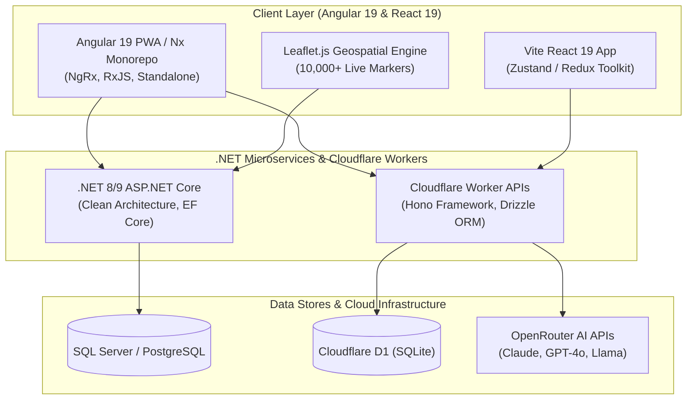

# Rasoul Veisi

  <h3>Senior Full-Stack Engineer</h3>
  
<strong>Angular Specialist | ASP.NET Core Microservices & Cloudflare Workers</strong>

  
  
  

---

## ⚡ About Me

I am a **Senior Full-Stack Engineer** with **5+ years of enterprise experience** building high-scale healthcare logistics software, digital publishing marketplaces, and serverless AI applications.

- 🏆 **Domain Expertise:** Primary frontend architect at **PharmaBits** (EU pharmacy workflow software), building modular **Angular (v13–19)** applications with **NgRx**, **RxJS**, and **standalone components**.
- 🛠️ **Full-Stack Capability:** Active collaborator on **.NET 8/9** ASP.NET Core microservices (EF Core, Clean Architecture) and **Cloudflare Workers** (Hono, D1 SQLite, Drizzle ORM).
- 🗺️ **Geospatial & Performance:** Engineered real-time Leaflet.js tracking engine rendering **10,000+ live map markers** with RxJS chunking at sub-60fps smoothness.
- 🧪 **Quality Discipline:** Maintained **80%+ automated test coverage** across high-risk modules with Jasmine, Karma, and Cypress (E2E).
- 🤖 **Agentic AI Workflow:** Deep integration of modern AI tools (**Cursor**, **Claude Code**, **Codex**, **MCP**) for rapid API contract scaffolding, refactoring, and test generation.

---

## 🏗️ Architecture & Stack Overview

---

## 🛠️ Tech Stack Matrix

| Category | Technologies & Tools |
|---|---|
| **Frontend Core** | Angular 13–19, RxJS, NgRx, Standalone Components, React.js, Next.js, Ionic/Capacitor |
| **Styling & UI** | Tailwind CSS, PrimeNG, Angular Material, Leaflet.js, Sass/SCSS, HTML5/CSS3 |
| **Backend & APIs** | .NET 8/9, ASP.NET Core, C#, EF Core, Cloudflare Workers, Hono, Drizzle ORM, REST APIs |
| **Databases & Auth** | SQL Server, Cloudflare D1 (SQLite), PostgreSQL, CouchDB, JWT, Clerk Auth |
| **Architecture & Tools** | npm / pnpm Monorepos, Nx, Clean Architecture, Docker, Git, Webpack, Vite |
| **Testing & Quality** | Jasmine, Karma, Cypress (E2E), MS Test |
| **AI & Automation** | Cursor, Claude Code, Codex, Model Context Protocol (MCP), Agentic Workflows |

---

## 🚀 Featured Flagship Repositories

### 🏥 [PhysioCoach AI](https://github.com/rasoulveisi/physiocoach-ai) ([Live Demo](https://physiocoach.otconnect.ir))
*AI physical therapy & rehabilitation monorepo*
- Dynamic onboarding, AI workout plan generation with strict JSON schema validation, and deterministic fallbacks.
- **Monorepo Stack:** Angular PWA + Capacitor (`web`), Cloudflare Worker Hono API (`api`), D1 Database, Drizzle ORM, Clerk Auth, OpenRouter AI.

### 🩺 [OT-Assistant](https://github.com/rasoulveisi/ot-assistant)
*Occupational therapy evaluation & activity planning monorepo*
- Automates client intake, AI activity plan generation, and clinical progress tracking.
- **Monorepo Stack:** Angular 19 (`web`), Cloudflare Worker Hono API (`api`), D1 (SQLite), Drizzle ORM, Clerk Auth, OpenRouter API.

### 💼 [Job Craft](https://job.otconnect.ir)
*Evidence-driven career application workspace*
- Full-stack job application tracker, AI resume customization workflow, and Telegram bot notification integration.
- **Stack:** Vite React 19, Cloudflare Worker (D1), Telegram Bot API, OpenRouter AI.

### ⚡ [Cloudflare Angular Starter](https://github.com/rasoulveisi/cf-boilerplate)
*Serverless monorepo starter*
- Production-ready template combining Angular 19 with Hono Cloudflare Worker API and shared TypeScript type safety.
- **Stack:** Angular, Hono, Cloudflare Workers, D1 Database, Drizzle ORM, npm Workspaces.

---

## 💼 Professional Experience Summary

### **Senior Full-Stack Developer** — **PharmaBits** (Sep 2022 – Present)
*EU Pharmacy Workflow Software (formerly BlueBitSoft)*
- Architected modular **Angular (v13–19)** features for Apoteek Logistiek (*APL*) handling prescription and inventory workflows.
- Co-developed **ASP.NET Core** backend APIs and **EF Core** data modeling.
- Rendered **10,000+ live courier markers** with Leaflet.js and RxJS chunking at 60fps.
- Enforced **80%+ test coverage** with Jasmine/Karma & Cypress.

### **PWA & E-Commerce Developer** — **Ketab.ir / BazarKetab** (Dec 2021 – Sep 2022)
- Built offline-first Angular + Ionic PWA with service workers and push notifications.
- Managed vendor dashboard inside an **Nx Monorepo**.

### **Frontend Developer** — **Zagros System** (Mar 2020 – Feb 2021)
- Built responsive client UIs with **React.js** and modern ES6+.

---

  © 2026 Rasoul Veisi · <a href="https://rasoulveisi.github.io">rasoulveisi.github.io</a>

